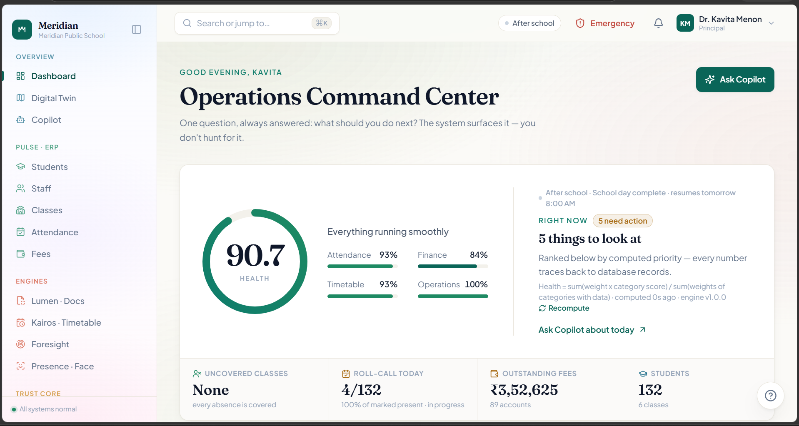

# Meridian

School operations with a **Next.js website, Express API, PostgreSQL + pgvector, Python analytics and face services, and a Flutter mobile app**. Website and mobile use the same school records and authenticated API.

Project author: Manaswi Guntupalli. Actual team responsibilities and contributions belong in [CONTRIBUTIONS.md](docs/dbms/CONTRIBUTIONS.md).

**Start here:** [run this configured computer](#run-on-the-configured-windows-computer) · [fresh-clone setup](#run-the-website-from-a-fresh-clone) · [find files for evaluation](#find-files-for-evaluation) · [project layout](PROJECT_LAYOUT.md) · [tech stack](techstack.md) · [technology justification](TECHNOLOGY%20JUSTIFICATION.md).



## Find files for evaluation

These are the current files to open when asked to demonstrate the implementation. [PROJECT_LAYOUT.md](PROJECT_LAYOUT.md) contains the expanded source map, feature-to-file index and SQL category map.

| Asked to show | Open this file or folder |
| --- | --- |
| Complete Chen ER diagram | [Chen ER SVG](database/rubric/diagrams/chen/01_complete_chen_er.svg) |
| ER-to-relational schema mapping | [Horizontal schema SVG](database/rubric/diagrams/relational/01_complete_relational_mapping.svg), [mapping explanation](database/rubric/diagrams/RELATIONAL_MAPPING.md) |
| Crow's-foot notation | [ER SVG](database/rubric/diagrams/01_complete_er_diagram.svg), [table-box schema SVG](database/rubric/diagrams/02_complete_relational_schema.svg) |
| Readable diagram pages and editable sources | [Diagram guide](database/rubric/diagrams/README.md), [Chen DOT sources](database/rubric/diagrams/sources/chen), [all diagram sources](database/rubric/diagrams/sources) |
| Current tables, attributes, PKs, FKs and constraints | [Live-catalogue schema dictionary](database/rubric/SCHEMA.md), [Prisma model](server/prisma/schema.prisma) |
| SQL queries and their actual expected outputs | [48-file query index](database/rubric/INDEX.md), [six-example walkthrough](database/rubric/SIX_EXAMPLE_DEMO.md) |
| CREATE / ALTER / DROP and DML | [DDL files](database/rubric/01_ddl), [DML files](database/rubric/02_dml) |
| JOIN / GROUP BY / HAVING / subqueries / recursive CTE | [Joins and aggregates](database/rubric/03_joins_and_aggregates), [subqueries and CTEs](database/rubric/04_subqueries_and_ctes) |
| Stored function, view, indexes and triggers | [Production advanced SQL](database/advanced.sql), [integrity SQL](database/integrity.sql), [advanced demonstrations](database/rubric/05_advanced_sql) |
| Vector database creation, semantic search and CRUD | [Vector examples](database/rubric/06_pgvector), [knowledge service](server/src/services/knowledge.ts), [Knowledge Library UI](client/src/views/Knowledge.tsx) |
| Backend authentication and authorization | [Auth middleware](server/src/middleware/auth.ts), [live account/session checks](server/src/lib/live-session.ts), [database permissions examples](database/rubric/07_permissions_and_integrity) |
| QR + face attendance logic | [Attendance engine](server/src/services/presence/engine.ts), [session routes](server/src/routes/presence/session.routes.ts), [dual-proof database migration](server/prisma/migrations/202611100002_dual_attendance/migration.sql) |
| API/database integration | [Route registry](server/src/routes/index.ts), [Prisma connection](server/src/lib/prisma.ts), [Next.js API rewrites](client/next.config.mjs) |
| Technology choices and architecture | [Technology justification](TECHNOLOGY%20JUSTIFICATION.md), [stack inventory](techstack.md), [system architecture](system-architecture.md) |
| Executed evidence and rubric coverage | [SQL verification](database/rubric/VERIFICATION.md), [diagram verification](database/rubric/diagrams/VERIFICATION.md), [testing record](docs/dbms/TESTING.md), [rubric map](database/rubric/RUBRIC_COVERAGE.md) |

The current database design has **43 application tables**; `_prisma_migrations` is internal bookkeeping. Complete posters are large: use SVG zoom or the seven module pairs for report pages.

## System components and ports

| Component | Address | Purpose | Startup dependency |
| --- | --- | --- | --- |
| Website | `http://localhost:5173` | Next.js serves the React application and forwards API/socket polling requests | Express API |
| API | `http://localhost:4000/api` | Authentication, school workflows, attendance, exports and realtime | School PostgreSQL; Python engines for their features |
| School PostgreSQL + pgvector | `127.0.0.1:5432`, database `meridian` | Persistent website/mobile records and semantic knowledge vectors | Initialized schema and matching local credentials |
| Intelligence service | `http://127.0.0.1:8010` | School-scoped statistical analytics and forecasts | Python dependencies and school PostgreSQL |
| Face service | `http://127.0.0.1:8020` | Detect faces and compute embeddings on CPU | Python dependencies and downloaded InsightFace model |
| SQL Lab PostgreSQL + pgvector | `127.0.0.1:5433` | Separate cluster, fictional template and disposable per-user playground databases | Provisioned SQL Lab template |

**pgvector is a PostgreSQL extension**, so there is no separate pgvector HTTP service. Flutter is a client, not a seventh backend service. SQL Lab's editable queries use its isolated cluster; the standalone rubric SQL files intentionally target the actual school database.

## Run on the configured Windows computer

Use this path on the existing computer where `.local/postgresql16`, both database clusters, Node dependencies, Python packages, `.env` files and application builds already exist. **Docker is not needed for this native setup.** These local database files and credentials are intentionally absent from GitHub.

Open PowerShell and run:

```powershell
Set-Location 'D:\DBMS MINI PROJECT\MERIDIAN'
npm run start:native
npm run check:services
Start-Process 'http://localhost:5173'
```

The background launcher starts stopped native databases, the built API, the built Next.js site and the two Python engines. It checks existing HTTP listeners before starting additional app processes. It **does not build, seed, reset, migrate or install dependencies**. Wait for face-model startup, then repeat the check if that model is still warming up.

The final check should contain **six `OK` lines**: Website, API, Intelligence, Face engine, School PostgreSQL + pgvector, and SQL Lab PostgreSQL. The direct school database probe checks pgvector and the School/KnowledgeItem schema. API `/api/health` alone indicates an HTTP process is alive and does not prove database connectivity.

Important details for this launcher:

- It uses `server/dist/src/index.js` and `next start`, so it needs a previous successful `npm run build`.
- It uses **`python` from PATH**, not a virtual-environment interpreter. The current workstation uses Python 3.14.0 with both services' packages installed there. If only venvs are installed, use the explicit foreground commands below instead.
- It starts the SQL Lab cluster only if `.local/postgres-lab-data/PG_VERSION` already exists. It is not a fresh native PostgreSQL installer. See [native installation details](docs/NATIVE_POSTGRES.md) for the existing layout.
- After application source changes: stop the affected built app processes, run `npm run build`, and start again. A healthy old process is not automatically replaced by this script.

### Logs and subsequent starts

Background process IDs are recorded in `.local/started-processes.json`. Logs are `.local/api.log`, `website.log`, `analytics.log`, `face.log` and their `*-error.log` counterparts. PostgreSQL logs are `.local/postgres.log` and `.local/postgres-lab.log`.

Tomorrow, repeat the same startup commands. Preserve `.local/postgres-data`, `.local/postgres-lab-data`, local environment files and document storage. **Do not rerun `npm run seed` on records you want to keep.**

### Stop the configured native setup

Close active app workflows first. Inspect the recorded PIDs before stopping background app processes; PID values can change between runs:

```powershell
$meridianRun = Get-Content -LiteralPath '.local/started-processes.json' -Raw | ConvertFrom-Json
$meridianServicePids = @($meridianRun.api, $meridianRun.website, $meridianRun.analytics, $meridianRun.face) |
    Where-Object { ($_ -as [int]) -gt 0 }
Get-CimInstance Win32_Process |
    Where-Object { $_.ProcessId -in $meridianServicePids } |
    Select-Object ProcessId, Name, CommandLine
```

Stop **only the verified Meridian app PIDs** with `Stop-Process -Id`, using the values just inspected. Foreground services should instead be stopped in their own terminals with Ctrl+C. The generic `dev:stop` helper force-stops web/API listeners only; it is not an all-service native shutdown command.

Then stop the two native database clusters cleanly, from the project root:

```powershell
& '.\.local\postgresql16\bin\pg_ctl.exe' -D '.\.local\postgres-lab-data' -m fast -w stop
& '.\.local\postgresql16\bin\pg_ctl.exe' -D '.\.local\postgres-data' -m fast -w stop
```

`fast` rolls back open database transactions and performs a normal PostgreSQL shutdown. It keeps database files. It is safe to close the computer after the intended app processes and both clusters have stopped.

## Run the website from a fresh clone

This reproducible path uses **Docker for the two PostgreSQL clusters**, with Node and Python on the host. It is an alternative to the configured native installation, not something to run alongside native clusters on the same ports. Compose starts databases only; it does not start Next.js, Express or Python.

### 1. Prerequisites and configuration

Install Git, Node.js **22**, Docker Desktop/Engine with Compose v2, and Python **3.11+**. Start Docker with Linux containers. Native InsightFace installation can require a C/C++ compiler and Python-compatible wheels; Windows may need Visual Studio Build Tools with Desktop development with C++. The checked local Python is 3.14.0. Initial packages/model downloads need internet access.

```powershell
git clone https://github.com/Manaswi-Guntupalli/MERIDIAN_DBMS_CS548_CS911.git
cd MERIDIAN_DBMS_CS548_CS911
node scripts/configure-local.mjs
$env:ONNXRUNTIME_NODE_INSTALL = 'skip'
npm ci
```

Configure **before** `npm ci`. The script creates missing `.env`, `server/.env` and `client/.env.local` files, generates local secrets and preserves existing files. The ONNX flag skips the optional Node GPU-runtime download; the project's local embedding path uses CPU inference.

### 2. Prepare both databases

```powershell
docker compose up -d --wait
npm run db:setup
npm run sql-lab:setup
```

`db:setup` applies [versioned migrations](server/prisma/migrations), generates Prisma Client and installs [advanced SQL](database/advanced.sql) and [integrity rules](database/integrity.sql). `sql-lab:setup` provisions the fictional template on the separately marked SQL Lab cluster. Do not replace this with `prisma db push`.

**Only for a new, disposable demo school database**, create the sample accounts and records:

```powershell
npm run seed
```

**The seed deletes existing application records in its configured school database.** It is an initial demo-data operation, not a repair or normal restart command. The original seed has 132 fictional students; later admissions can change the live count.

### 3. Install the Python engines

From the repository root, using explicit interpreters avoids activating environments or changing PowerShell execution policy:

```powershell
python -m venv intelligence/.venv
./intelligence/.venv/Scripts/python.exe -m pip install --upgrade pip
./intelligence/.venv/Scripts/python.exe -m pip install -r intelligence/requirements.txt

python -m venv faceservice/.venv
./faceservice/.venv/Scripts/python.exe -m pip install --upgrade pip
./faceservice/.venv/Scripts/python.exe -m pip install -r faceservice/requirements.txt
```

### 4. Start the application services

Open three terminals in the repository root and keep them running.

**Terminal 1 — website and API:**

```powershell
npm run dev
```

**Terminal 2 — intelligence:**

```powershell
./intelligence/.venv/Scripts/python.exe -m uvicorn app.main:app --app-dir intelligence --host 127.0.0.1 --port 8010
```

**Terminal 3 — face service:**

```powershell
./faceservice/.venv/Scripts/python.exe -m uvicorn app:api --app-dir faceservice --host 127.0.0.1 --port 8020
```

In another terminal, run `npm run check:services` and open **http://localhost:5173** after all six checks pass. InsightFace downloads its model on first startup. MiniLM downloads on first Knowledge Library use; scanned-document OCR may also download its language data. A missing engine leaves its corresponding feature unavailable.

For macOS/Linux, use `python3` to create venvs, `intelligence/.venv/bin/python` and `faceservice/.venv/bin/python` in the two engine commands, and `ONNXRUNTIME_NODE_INSTALL=skip npm ci` during Node installation. `start:native` is Windows-specific.

### Built mode, later starts and Docker shutdown

After dependencies and databases exist, this switches the website/API to built mode:

```powershell
npm run build
npm start
```

Stop dev web/API first to free ports 4000/5173. Keep the Python engines and selected database installation running separately. `npm start` starts **only** the API and website.

On subsequent Docker-based starts: `docker compose up -d --wait`, then the three application terminals. Stop foreground services with Ctrl+C and use `docker compose stop` for databases. Named volumes preserve data; `docker compose down -v` deletes them. Apply `npm run db:setup` after new migrations and rebuild built services after source changes.

## Local configuration and demo accounts

| File | Purpose |
| --- | --- |
| `.env` | Compose's school/lab database initialization credentials |
| `server/.env` | School/test/lab URLs, JWT and document keys, Python origins and optional provider settings |
| `client/.env.local` | `API_ORIGIN` for server-side rewrites; optional direct Socket.IO browser origin |

Templates are [root .env.example](.env.example), [server .env.example](server/.env.example) and [client .env.example](client/.env.example). Preserve existing database credentials and `LUMEN_STORAGE_KEY`; changing an env file does not reset an existing PostgreSQL password or decrypt documents encrypted with another key. Actual configuration, database clusters and backups are ignored by Git.

The freshly seeded demo accounts use **`meridian123`**. Existing or provisioned accounts can have changed/temporary passwords.

| Role | Demo email |
| --- | --- |
| Principal | `principal@meridian.school` |
| Administrator | `admin@meridian.school` |
| Super administrator | `super@meridian.school` |
| Teacher | `teacher@meridian.school` |
| Student | `student@meridian.school` |
| Parent | `parent@meridian.school` |

## Run the Flutter app

Start the API, school database and both Python engines first. Flutter shares the API/database; it does not install or start the server stack. Full device/iOS instructions are in [flutter_app/README.md](flutter_app/README.md).

Baseline: **Flutter 3.38.5 / Dart 3.10.4**, Android Studio/SDK 36 and an Android API 24+ phone or emulator. Java 17 is the app's bytecode target. iOS needs a Mac, Xcode/CocoaPods and iOS 15+; iOS builds were not verified on this Windows machine.

### USB Android phone

Enable USB debugging, connect the phone, approve its debugging prompt, and make Android `platform-tools` available in PATH:

```powershell
adb devices
adb -s DEVICE_ID reverse tcp:4000 tcp:4000
cd flutter_app
flutter pub get
flutter devices
flutter run --debug -d DEVICE_ID --dart-define=MERIDIAN_API_BASE=http://127.0.0.1:4000
```

Replace `DEVICE_ID` with the actual authorized device ID. If `adb` is not on PATH, use the executable under your Android SDK's `platform-tools` directory. Repeat USB reverse after reconnecting/rebooting the phone.

| Target | `MERIDIAN_API_BASE` |
| --- | --- |
| USB phone with reverse mapping | `http://127.0.0.1:4000` |
| Standard Android emulator | `http://10.0.2.2:4000` |
| Wi-Fi phone, debug build | `http://YOUR_PC_LAN_IP:4000` |
| Deployed backend | `https://YOUR_API_HOST` |

Use the Express origin **without `/api` and without a trailing slash**. This value is compiled into the app: rebuild after changing it. For Wi-Fi, first confirm the phone can open `http://YOUR_PC_LAN_IP:4000/api/health`; the API must be reachable through the private-network firewall. Keep database/Python ports private.

### APK builds

From `flutter_app/`, for a USB demo:

```powershell
flutter build apk --debug --dart-define=MERIDIAN_API_BASE=http://127.0.0.1:4000
flutter build apk --profile --dart-define=MERIDIAN_API_BASE=http://127.0.0.1:4000
flutter build apk --release --split-per-abi --dart-define=MERIDIAN_API_BASE=http://127.0.0.1:4000
flutter build apk --release --dart-define=MERIDIAN_API_BASE=http://127.0.0.1:4000
adb -s DEVICE_ID install -r build/app/outputs/flutter-apk/app-arm64-v8a-release.apk
```

Outputs are under `flutter_app/build/app/outputs/flutter-apk/`. Use ARM64 for an ARM64 phone or the universal `app-release.apk`. Release builds permit HTTP **only for loopback** (`127.0.0.1`/`localhost`) for USB reverse; network hosts require HTTPS. Debug builds allow local LAN HTTP. Current release signing uses the demo/debug key, not a store-release signing setup.

## Main workflows and implementation boundaries

- **School operations:** role-scoped students, teachers, classes, fees, payments, notices and dashboards.
- **Attendance:** a valid session QR and a matching enrolled face are both required for the same student/session, in either order. One factor stays pending. A mismatch is blocked. Legacy manual endpoints cannot bypass the rule to set Present/Late; Absent/Leave corrections remain available. See [classroom test steps](docs/QR_ATTENDANCE.md).
- **Lumen:** PDF text extraction, local OCR, evidence, review and verified student/teacher creation. Uploaded documents are encrypted on disk; poor scans still need human correction.
- **Kairos:** constraint-based timetable generation, validation, approval/publication, history and substitute planning.
- **Foresight:** Python statistical analytics and recommendations from a read-only school database transaction. Unavailable engines/data are reported explicitly.
- **Knowledge Library:** real MiniLM text embeddings and native pgvector retrieval/CRUD. Model name, metadata and audit revisions are stored with entries.
- **Trust Core:** events/audit history and selected reversible actions. It is not a full database backup/restore mechanism.

Backend authentication checks the live account and role. Database constraints and triggers protect integrity; KnowledgeItem additionally uses a restricted PostgreSQL role and RLS. This does **not** mean every operational route is protected by database RLS. See the [architecture](system-architecture.md) and [technology justification](TECHNOLOGY%20JUSTIFICATION.md).

## Technology stack

Versions below are the checked-in Node lockfile baseline or the verified local runtime; use lockfiles instead of upgrading packages during a demo. The [full inventory](techstack.md) identifies supporting libraries and Python/Flutter version sources.

| Layer | Technologies | Source |
| --- | --- | --- |
| Web | Next.js **16.4.1**, React **18.3.1**, TypeScript **5.9.3**, Tailwind CSS **3.4.19** | [client/package.json](client/package.json), [package-lock.json](package-lock.json) |
| Client data/UI | React Router 7, TanStack Query 5, Zustand 5, Axios, Socket.IO client, Recharts, Framer Motion, Lucide, QRCode | [client source](client/src), [client manifest](client/package.json) |
| API | Node.js **22.21.0**, Express **4.22.3**, Prisma **5.22.0**, `pg` **8.23.1**, Socket.IO **4.8.3** | [server manifest](server/package.json), [API entry](server/src/index.ts) |
| Authentication/validation | JWT (`jsonwebtoken`), bcryptjs, Zod, live account checks, PostgreSQL constraints/RLS | [middleware](server/src/middleware/auth.ts), [advanced SQL](database/advanced.sql) |
| Database | Native PostgreSQL **16.15** + pgvector **0.8.7** on this machine; Compose alternative uses `pgvector/pgvector:pg16` | [Prisma schema](server/prisma/schema.prisma), [Compose](docker-compose.yml) |
| Knowledge embeddings | Transformers.js **4.3.1**, `Xenova/all-MiniLM-L6-v2`, mean-pooled normalized **384-D** vectors | [knowledge.ts](server/src/services/knowledge.ts) |
| Analytics | Python **3.14.0** locally; FastAPI, Uvicorn, Pydantic, pandas, NumPy, SciPy, scikit-learn, psycopg | [requirements](intelligence/requirements.txt), [engine](intelligence/app/inference/engine.py) |
| Face engine | FastAPI, InsightFace `buffalo_l`, ONNX Runtime CPU, OpenCV; **512-D** embeddings | [face app](faceservice/app.py), [Node matching](server/src/services/face.ts) |
| Documents/exports | PDF.js, Tesseract.js, Sharp, canvas, PDFKit, ExcelJS; Node crypto AES-256-GCM | [Lumen](server/src/services/lumen), [requirements](server/package.json) |
| Mobile | Flutter **3.38.5**, Dart **3.10.4**, Riverpod, Dio, GoRouter, secure storage, mobile_scanner, camera | [pubspec](flutter_app/pubspec.yaml), [Flutter lockfile](flutter_app/pubspec.lock) |
| Verification/tooling | Vitest/Supertest, pytest, Flutter tests, Playwright, GitHub Actions, npm workspaces; Graphviz/Viz.js for diagrams | [CI](.github/workflows/dbms.yml), [diagram tools](database/rubric/tools) |

The current web server is Next.js. SQLite, Redis and Vite are not the active database/server stack. PGlite remains available only as a legacy isolated QA tool. Face templates are stored as serialized vectors in PostgreSQL text fields and matched by Node; **KnowledgeItem** is the native `vector(384)`/HNSW feature.

## Project layout

```text
MERIDIAN/
|-- README.md                         Run instructions and evaluator entry point
|-- PROJECT_LAYOUT.md                 Detailed file/feature lookup
|-- TECHNOLOGY JUSTIFICATION.md       Technology decisions and trade-offs
|-- techstack.md                      Code-backed dependency inventory
|-- system-architecture.md            Services, data paths and trust boundaries
|-- client/                           Next.js + React web application
|   |-- src/app/                      Next.js entry/layout/client boundary
|   |-- src/views/                    School, Presence, Knowledge and SQL Lab UI
|   `-- src/{lib,hooks,store}/         API, realtime and client state
|-- server/
|   |-- prisma/{schema.prisma,migrations,seed.ts}
|   |-- src/{routes,middleware,services,lib}/
|   |-- sql-lab/                      Native sandbox worker and fictional seed
|   `-- tests/                        Integration/regression tests
|-- database/
|   |-- advanced.sql                  pgvector, roles/RLS, functions, view, audit
|   |-- integrity.sql                 Cross-school and calendar validation
|   `-- rubric/                       SQL files, outputs, schemas and diagrams
|-- intelligence/                     Python statistical analytics service
|-- faceservice/                      Python face embedding service
|-- flutter_app/                      Flutter Android/iOS companion
|-- scripts/                          Setup, startup, health and browser checks
|-- docs/                             Feature guides, report and screenshots
`-- .github/workflows/dbms.yml         Native PostgreSQL CI verification
```

Generated builds, `node_modules`, `.local`, private `.env` files and `tmp` are not submitted source. Some ignored folders contain live data: on this configured machine document storage is `tmp/repaired-demo/documents`. Do not blanket-delete `tmp` or `.local` as cleanup; retain the configured document directory, encryption key and matching database backup.

## Run checks and tests

From the repository root:

```powershell
npm run check:services
npm --prefix server run typecheck
npm --prefix client run typecheck
npm --prefix server run test
node database/rubric/tools/verify-diagrams.mjs
python database/rubric/tools/verify-diagram-assets.py
```

Backend tests require a **separate** `TEST_DATABASE_URL` ending in `_test`, different from `DATABASE_URL`. Test setup applies migrations and synthetic fixtures there. Compose's initial SQL creates `meridian_test`; existing installations must provide it without deleting school data. Native diagram verification uses read-only transactions on the school DB. Image verification needs Python/Pillow and the system Arial fonts used by the Windows exports.

Additional checks:

```powershell
# School DB demonstrations: all rows/DDL roll back; audit sequences can advance.
node database/rubric/run-examples.mjs --verify
npm run db:verify

# Analytics tests (fresh-clone venv setup):
Push-Location intelligence
./.venv/Scripts/python.exe -m pytest tests
Pop-Location

# Mobile checks:
Push-Location flutter_app
flutter test
flutter analyze
Pop-Location
```

Use `python -m pytest tests` inside `intelligence/` on the existing workstation where the service packages are on PATH. These are reproducible check commands; listing them does not claim a fresh execution of every suite. Hardware face/optical QR checks still need a consenting enrolled person and a camera. [Recorded testing results](docs/dbms/TESTING.md), [SQL evidence](database/rubric/VERIFICATION.md) and [diagram evidence](database/rubric/diagrams/VERIFICATION.md) identify executed scopes and dates.

## Optional providers and networking

Core school operations, local OCR, semantic embeddings and local face inference need no external API key after dependencies/models are available. OpenAI prose features, Twilio SMS, SendGrid email and Firebase remote push need their own configuration. In-app Socket.IO updates/local notifications are distinct from closed-app remote push delivery. See [OpenAI setup](docs/OPENAI.md) and [notification providers](docs/NOTIFICATIONS.md). `npm run configure:openai` is the existing hidden-prompt configuration helper.

The browser normally uses relative `/api` and the Next.js rewrite. `CLIENT_ORIGIN` is the browser website origin; do not replace it with a native phone address. `API_ORIGIN` configures the Next server's backend destination. Browser cameras need localhost or HTTPS. Native Flutter uses camera permissions and its compiled API base.

## Troubleshooting

| Symptom | Check |
| --- | --- |
| Native launcher cannot find PostgreSQL | It requires the existing ignored `.local` installation. Use the fresh-clone path on another machine. |
| Native Python import fails | The launcher uses PATH `python`; install with that interpreter or start the two venv commands explicitly. |
| Built site/API will not start | Confirm `server/dist/src/index.js` and `client/.next/BUILD_ID`; run `npm run build` after stopping conflicting app processes. |
| Port already in use | Do not run native and Docker clusters together on 5432/5433, or dev/built apps together on 4000/5173. Inspect the owner before stopping it. |
| School database check fails | Verify the chosen PostgreSQL installation and existing matching URL; apply setup only for missing schema/new migrations. Reseeding is not a connection fix. |
| SQL Lab check fails | Verify its separate cluster marker, admin URL and provisioned template; run `npm run sql-lab:setup` on an initialized dedicated lab cluster. |
| PostgreSQL password fails | An existing cluster/volume retains its original password; env edits do not change it. Restore matching configuration. |
| `vector` extension missing | Use the Compose pgvector image or install matching pgvector into native PostgreSQL before schema setup. |
| Face/embedding/OCR cold start fails | Check the corresponding logs, interpreter and first-download network access; repeat health checks after model startup. |
| Phone cannot connect | Check API port 4000, USB reverse or the actual LAN IP, firewall access, and the APK's compiled base. |
| Release APK fails on LAN HTTP | Use HTTPS for network hosts. Release HTTP is permitted only for localhost/127.0.0.1 USB forwarding. |
| Saved document cannot decrypt | Restore the correct storage directory and its original `LUMEN_STORAGE_KEY`; new keys or reseeding do not recover old ciphertext. |

## Documentation and demonstration

- [Project layout and viva lookup](PROJECT_LAYOUT.md), [technology justification](TECHNOLOGY%20JUSTIFICATION.md), [architecture](system-architecture.md), [quick run guide](HOW%20TO%20RUN.md).
- [SQL/rubric guide](database/rubric/README.md), [query index](database/rubric/INDEX.md), [six-example demo](database/rubric/SIX_EXAMPLE_DEMO.md), [rubric map](database/rubric/RUBRIC_COVERAGE.md), [current diagrams](database/rubric/diagrams/README.md).
- [Native PostgreSQL details](docs/NATIVE_POSTGRES.md), [SQL Lab architecture](docs/dbms/SQL_LAB.md), [QR + face test](docs/QR_ATTENDANCE.md), [face enrollment](docs/FACE_RECOGNITION.md), [mobile setup](flutter_app/README.md).
- [Course report](docs/dbms/REPORT.md), [testing evidence](docs/dbms/TESTING.md), [screenshots](docs/screenshots/README.md), [audit screenshots](docs/audit/screenshots), [actual team contributions](docs/dbms/CONTRIBUTIONS.md).

Technical files cannot establish individual contribution or viva performance. Complete the contribution record truthfully and be ready to explain and modify your own database/application work.
