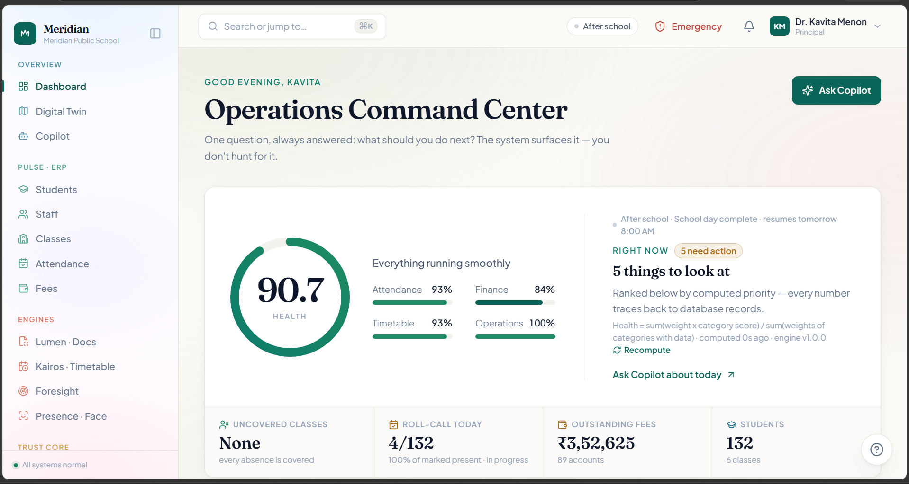

# Meridian

A school operations platform with a Next.js website, Express API, PostgreSQL + pgvector, Python analytics and face services, and a Flutter mobile companion. Web and mobile use the **same API and school database**.

Project by Manaswi Guntupalli.



**Start here:** [website setup](#run-the-website-from-a-fresh-clone) · [Flutter setup](#run-the-flutter-app) · [troubleshooting](#troubleshooting) · [verification](#run-checks-and-tests).

## What is implemented

| Area | Current implementation |
| --- | --- |
| Pulse | Role-based students, staff, classes, attendance and fees workflows. |
| Lumen | PDF text extraction or local Tesseract OCR, template-based fields, review, evidence highlights, exports and supported student/teacher commits. OCR runs in **Node**, not the Python analytics service. Bad scans need human correction. |
| Kairos | Timetable generation, review, publication, versions and substitute planning. |
| Foresight | Python statistical forecasts, anomaly detection and explainable recommendations. |
| Presence | Session-based attendance, server-side face embeddings and QR workflows. Camera/device checks require compatible hardware and permissions. |
| Copilot and reports | Live-data summaries, reviewed actions, report regeneration and print/PDF export. Optional OpenAI generation; data-based fallbacks are labelled. |
| Knowledge Library | PostgreSQL/pgvector CRUD, 384-dimensional MiniLM embeddings, similarity search, revision triggers and database role policies. |
| SQL Lab | Editable SQL, schema explorer, results, examples, history, CSV and reset. Each administrator gets a **separate disposable PGlite PostgreSQL/pgvector cluster with fictional data**. Editable SQL never uses the school database connection. |
| Trust Core | Event/audit history and selected reversible actions. Time Machine is not a full database backup/restore system. |
| Flutter | Principal, teacher, student and parent experiences using the same backend, with role-scoped data, QR/camera capture and realtime notifications. It is a mobile companion, not a complete copy of every web screen. |

### Services and ports

| Component | Stack | Local address |
| --- | --- | --- |
| Website | Next.js 16, React, TypeScript | `http://localhost:5173` |
| Authenticated API | Express, Prisma, Socket.IO | `http://localhost:4000/api` |
| School database | PostgreSQL 16 + pgvector | `localhost:5432` |
| Analytics engine | FastAPI, NumPy/pandas, SciPy, scikit-learn | `http://localhost:8010` |
| Face engine | FastAPI, InsightFace, ONNX Runtime CPU | `http://localhost:8020` |
| SQL playground | PGlite child processes inside the API deployment | No extra port or database credentials |

The website proxies `/api` and Socket.IO polling to Express. Express calls the Python services; Flutter connects directly to Express. **pgvector is a PostgreSQL extension**, not a separate database server.

## Run the website from a fresh clone

The primary instructions below use **Windows PowerShell**. macOS/Linux differences are included where commands differ. Run commands from the repository root unless another directory is explicitly shown.

### 1. Install prerequisites

- **Git**, **Node.js 22 LTS** and npm. `.nvmrc` specifies Node 22; recent verification used Node 22.21.0. Do not use Node 18.
- **Docker Desktop** with Docker Compose v2 and Linux containers; start Docker Desktop before starting PostgreSQL. macOS/Linux can use Docker Engine + Compose instead.
- **Python 3.11+** for the Python engines. Python 3.14 has been exercised locally. Install Python with its executable available in your terminal.
- The face engine may need a native compiler when pip builds InsightFace: on Windows, install **Visual Studio Build Tools → Desktop development with C++**, including the Windows SDK. On Linux, install the distribution's C/C++ build tools and Python development headers if a wheel is unavailable.
- Internet access for initial npm/pip packages and model downloads. Flutter/Android tooling is needed only for mobile; see below.

Check these before cloning:

```powershell
git --version
node --version
npm --version
python --version
docker --version
docker compose version
```

On macOS/Linux, use `python3` instead of `python` if that is your installed Python command.

### 2. Clone and configure BEFORE installing

```powershell
git clone https://github.com/Manaswi-Guntupalli/MERIDIAN_DBMS_CS548_CS911.git
cd MERIDIAN_DBMS_CS548_CS911
node scripts/configure-local.mjs
```

The configuration command creates ignored `.env`, `server/.env`, and `client/.env.local` files **only when missing**. A fresh configuration gets matching Docker/API database credentials, a random JWT secret and a separate Lumen storage key. It does not print secrets or replace existing settings. No OpenAI, Twilio, SendGrid or Firebase account is required for the default local demo.

Keep these files on this computer. Preserve `LUMEN_STORAGE_KEY` with document-storage backups: changing it makes encrypted documents unreadable. If you already have `.env` files or an existing Docker database volume, verify their credentials agree; rerunning this command is not a password reset.

Install the locked Node dependencies. The CPU ONNX runtime is bundled; skip the optional GPU runtime download:

```powershell
$env:ONNXRUNTIME_NODE_INSTALL = 'skip'
npm ci
```

macOS/Linux equivalent:

```bash
ONNXRUNTIME_NODE_INSTALL=skip npm ci
```

### 3. Create the database and apply the schema

```powershell
docker compose up -d --wait
npm run db:setup
```

Compose starts `pgvector/pgvector:pg16` with persistent volume `meridian_dbms_pgdata`. On the **first** database initialization it also creates `meridian_test`. `db:setup` applies versioned Prisma migrations, generates the Prisma client, and installs vector indexes, views, functions, constraints, triggers and role policies. Do not substitute `prisma db push`.

**Only for a new disposable demo database**, populate sample records:

```powershell
npm run seed
```

**`seed` deletes existing application records in the database selected by `server/.env`. Never rerun it to fix a connection error or on a database with records you want to keep.** The seed creates 132 fictional students, 11 teachers, six classes and demo accounts. Do not expose this seeded environment to the public internet.

After dependencies and Docker are ready, `npm run setup` is a configuration/schema shortcut only; it **does not seed or delete school records**. The initial seed remains a separate, explicit command.

### 4. Install each Python service in its own virtual environment

Windows PowerShell, from the repository root:

```powershell
python -m venv intelligence/.venv
./intelligence/.venv/Scripts/python.exe -m pip install --upgrade pip
./intelligence/.venv/Scripts/python.exe -m pip install -r intelligence/requirements.txt

python -m venv faceservice/.venv
./faceservice/.venv/Scripts/python.exe -m pip install --upgrade pip
./faceservice/.venv/Scripts/python.exe -m pip install -r faceservice/requirements.txt
```

macOS/Linux:

```bash
python3 -m venv intelligence/.venv
./intelligence/.venv/bin/python -m pip install --upgrade pip
./intelligence/.venv/bin/python -m pip install -r intelligence/requirements.txt

python3 -m venv faceservice/.venv
./faceservice/.venv/bin/python -m pip install --upgrade pip
./faceservice/.venv/bin/python -m pip install -r faceservice/requirements.txt
```

No environment activation is necessary with these explicit interpreter paths. They avoid PowerShell activation-policy problems and accidentally installing packages into another Python installation.

### 5. Start three terminals and keep them running

Open each terminal in `MERIDIAN_DBMS_CS548_CS911`.

**Terminal 1 — website and API:**

```powershell
npm run dev
```

**Terminal 2 — analytics, Windows:**

```powershell
./intelligence/.venv/Scripts/python.exe -m uvicorn app.main:app --app-dir intelligence --host 127.0.0.1 --port 8010
```

**Terminal 3 — face service, Windows:**

```powershell
./faceservice/.venv/Scripts/python.exe -m uvicorn app:api --app-dir faceservice --host 127.0.0.1 --port 8020
```

On macOS/Linux use the same commands with `./intelligence/.venv/bin/python` and `./faceservice/.venv/bin/python` respectively.

The face service's first startup downloads the `buffalo_l` model pack (about 281 MB). Wait for startup to complete. Knowledge Library's first embedding downloads MiniLM from Hugging Face; Lumen's first scanned-document read may download Tesseract's English language data. These cold starts can take longer than subsequent requests.

The npm aliases `intelligence`, `faceservice`, and their `:install` variants use whichever `python` is on PATH. Prefer the explicit commands above when using separate virtual environments.

### 6. Check services, open the site and sign in

In a fourth terminal, from the repository root:

```powershell
npm run check:services
```

All four lines should report `OK`. This checks the website, API health, analytics database connectivity and loaded face model. It does not verify a phone camera or external message delivery.

Open **http://localhost:5173**. Demo accounts all use password **`meridian123`**:

| Role | Email |
| --- | --- |
| Principal | `principal@meridian.school` |
| Administrator | `admin@meridian.school` |
| Super administrator | `super@meridian.school` |
| Teacher | `teacher@meridian.school` |
| Student | `student@meridian.school` |
| Parent | `parent@meridian.school` |

Health endpoints: `/api/health` on port 4000, `/health` on 8010 and `/health` on 8020. Optional engines may be omitted for basic CRUD, but forecasts and face verification need their respective services. Missing engines are not a complete-feature setup.

### Subsequent starts and stopping

On the next day, **do not reseed**. Start Docker Desktop, run `docker compose up -d --wait`, then start the same three terminals. Run `npm run db:setup` after pulling new migrations; rebuild/restart services after relevant configuration changes.

Stop each foreground terminal with Ctrl+C. `docker compose stop` stops PostgreSQL while keeping its data. `docker compose down` also preserves the named volume; **do not add `-v`** unless deliberately destroying the demo database.

To run the optimized web/API build locally, stop the dev web/API process first:

```powershell
npm run build
npm start
```

Keep the two Python services running separately. This builds/runs the application; it is not a public deployment or TLS configuration.

## Run the Flutter app

The backend and PostgreSQL must already be running. **Flutter does not create a database or run the Node/Python services.** For face workflows, run the face service too.

The full mobile instructions, Android emulator/USB/Wi-Fi commands, iOS setup, APK installation and troubleshooting are in **[flutter_app/README.md](flutter_app/README.md)**.

Quick Android-emulator route, after installing Flutter + Android Studio and starting an emulator:

```powershell
cd flutter_app
flutter --version
flutter doctor -v
flutter doctor --android-licenses
flutter pub get
flutter devices
flutter run --debug -d DEVICE_ID --dart-define=MERIDIAN_API_BASE=http://10.0.2.2:4000
```

Replace `DEVICE_ID` with the ID printed by `flutter devices`, for example `emulator-5554`. Read and accept the SDK licenses yourself when prompted. The verified SDK was **Flutter 3.38.5 / Dart 3.10.4**; `pubspec.yaml` requires Dart `^3.10.4`. Use that Flutter version to reproduce the checked dependency set rather than upgrading SDKs/packages together.

For a **USB-connected Android phone**, run `adb reverse tcp:4000 tcp:4000` and use `--dart-define=MERIDIAN_API_BASE=http://127.0.0.1:4000`. For a **Wi-Fi phone**, use the computer's LAN IP, such as `http://192.168.1.50:4000`, not `localhost` or `10.0.2.2`.

The value is the Express origin: **port 4000, no `/api` suffix, no trailing slash**. It is compiled into the app; after changing it, stop and rerun/rebuild rather than hot reload. Sign in with the same seeded accounts as the website. Default builds do not need Firebase configuration.

## Optional providers and networking

- OpenAI is optional. Run `npm run configure:openai` to save a fresh key through a hidden terminal prompt, restart API/intelligence services, then use **Super Admin Settings → OpenAI connection → Test connection**. Without a working key, Lumen uses local text/OCR processing, report summaries use templates, and AI notice drafting is unavailable while manual notices remain available. Supplying a key sends relevant prompts/document text to the provider and incurs usage charges. See [OpenAI setup and feature verification](docs/OPENAI.md).
- SMS/email/remote push use **Twilio, SendGrid and Firebase**. They stay disabled until configured. See [provider activation](docs/NOTIFICATIONS.md); Socket.IO/in-app notifications do not prove closed-app push delivery.
- For native Flutter, only the Express endpoint must be reachable by the phone. Keep PostgreSQL and Python engines local. Do not change `CLIENT_ORIGIN` to a phone IP: it is the **browser website's origin**, including its port.
- `client/.env.local` uses `API_ORIGIN` for the server-side Next rewrite. Leave `NEXT_PUBLIC_SOCKET_ORIGIN` empty for same-origin polling, or set it to a directly reachable API origin. For a browser on another computer, update `CLIENT_ORIGIN` and any direct socket origin accordingly, then restart; `NEXT_PUBLIC_*` changes also require rebuilding a production build.
- Browser camera capture requires localhost or a secure HTTPS context. Native Flutter camera access uses Android/iOS permissions and does not require exposing the Python face service.

## Run checks and tests

From the repository root, after Node installation and database setup:

```powershell
npm --prefix client run typecheck
npm --prefix server run typecheck
npm run build
npm --prefix server run test
```

`server/.env` must contain a **separate** `TEST_DATABASE_URL` whose database name ends in `_test`. Test setup applies schema there and creates synthetic fixtures; it refuses the development database URL. Compose creates `meridian_test` only on first initialization. If your existing volume lacks it, create it without deleting the volume:

```powershell
docker compose exec db sh -c 'createdb -U "$POSTGRES_USER" meridian_test'
```

Database assertions run inside a rollback-only transaction against the database in `server/.env`. From the repository root:

```powershell
npm run db:verify
```

This installs no schema, so run `db:setup` first. It deliberately rolls back its temporary verification fixtures. See [testing evidence](docs/dbms/TESTING.md) for the exact scope and historical CI runs.

Python tests, Windows:

```powershell
cd intelligence
./.venv/Scripts/python.exe -m pytest
cd ..
```

Flutter checks, from `flutter_app/`:

```powershell
flutter analyze
flutter test
flutter build apk --debug --dart-define=MERIDIAN_API_BASE=http://10.0.2.2:4000
```

Browser checks require the running services and a locally installed Playwright-compatible browser. Examples: `node scripts/verify-sql-lab.mjs`, `node scripts/verify-report-regeneration.mjs`, and `node scripts/verify-report-print.mjs`. Set `BROWSER_EXECUTABLE` to a browser executable if Playwright browsers are not installed. SQL Lab writes go only to its sandbox; report generation adds normal audit entries.

## Troubleshooting

| Symptom | What to check |
| --- | --- |
| `docker` unavailable / daemon not running | Install/start Docker Desktop; use Linux containers; reopen your terminal after installation. |
| Port 5432 already used | Stop your other local PostgreSQL or deliberately change Compose's host port and both database URLs. Do not attach a different existing volume accidentally. |
| PostgreSQL password authentication fails | Root `.env`, server URLs and the initialized volume must agree. Updating `.env` does not update a password stored in an existing PostgreSQL cluster. Do not delete the volume as a shortcut. |
| `vector` extension unavailable | Use the Compose pgvector image. A plain PostgreSQL installation needs pgvector installed before `db:setup`. The migration account also needs permission to create the extension and database roles. |
| API says database connection failed | Run `docker compose ps`, confirm health and credentials, then run `npm run db:setup`. Do not use `seed` as a connection repair. |
| `ModuleNotFoundError` in Python | Install requirements using the exact virtual-environment interpreter used to start that service. |
| InsightFace wheel/build failure | Install native build tools or use a Python version with compatible package wheels; rerun its venv's pip install. Check network access for the model download. |
| Forecasts offline / face model unavailable | Start the appropriate Python terminal and check its `/health`; allow the initial model download to finish. |
| Knowledge embeddings or first OCR read fails | Check model/language-data download access and logs. CPU ONNX installation does not require CUDA. |
| `EADDRINUSE` on 4000/5173 | Stop the duplicate web/API instance. `npm run dev:stop` is an explicit force-stop helper that kills listeners on 4000/5173/5174; inspect them before using it. |
| Phone cannot sign in | Test `http://PC_LAN_IP:4000/api/health` from the phone; check Wi-Fi, private-network firewall access and the compiled `MERIDIAN_API_BASE`. For USB use `adb reverse`. |
| Android release APK cannot reach HTTP | Release transport policy requires HTTPS. Use a debug build for local HTTP or an HTTPS backend for release. |
| Encrypted Lumen preview/original missing | Restore the original storage key and matching files/database backup. Reseeding or replacing JWT/storage keys does not recover old files. |

## Documentation and demonstration

- [SQL Lab presentation guide](docs/dbms/SQL_LAB.md), [rubric mapping](docs/dbms/RUBRIC.md), [schema/ER diagram](docs/dbms/SCHEMA.md), [DBMS report](docs/dbms/REPORT.md), [demo guide](docs/dbms/DEMO.md).
- [Setup verification and platform limits](docs/SETUP_VERIFICATION.md), [testing evidence](docs/dbms/TESTING.md), [repair record and remaining limits](docs/audit/REMEDIATION.md), [historical audit](docs/audit/COMPLETE_AUDIT.md), [notification providers](docs/NOTIFICATIONS.md).
- [Web walkthrough](https://drive.google.com/file/d/1XiFDfz1RLQ4IhYxchJI3ik3Bu4OIdWdm/view), [mobile walkthrough](https://drive.google.com/file/d/1n_vcO8DhqhWMGlWz1RQwOzrBMm2tdJof/view), [screenshot catalogue](docs/screenshots/README.md). Videos/screenshots can show older builds; the source and current verification records define present behaviour.

## Repository layout

```text
client/          Next.js website
server/          Express API, Prisma migrations, Lumen, SQL Lab worker
database/        Advanced SQL, integrity constraints, Docker initialization
intelligence/    Python analytics engine (not Lumen OCR)
faceservice/     Python face embedding service
flutter_app/     Flutter mobile companion
scripts/         Local configuration and verification tools
docs/            Design, evaluation, guides and audit evidence
```
