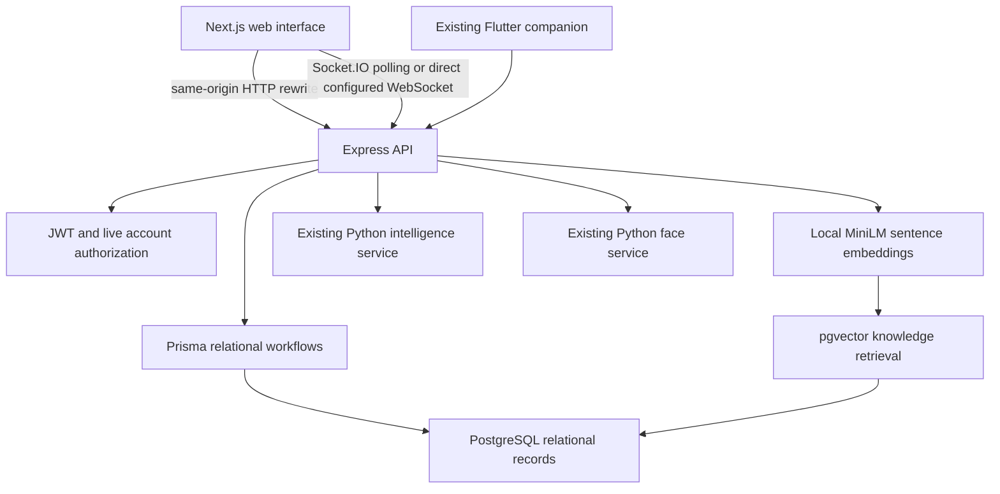

# Meridian: Trust-first School Operations and Semantic Knowledge Retrieval

## Objectives and problem

Schools need more than a register: timetable conflicts, attendance verification, fee consistency, document processing and finding the correct policy cross several workflows. Meridian joins these operations with traceable decisions and database-enforced integrity. This submission extends the author's existing Meridian application; it does not claim that the prior code was newly written for this course.

## Functional requirements

- Authenticate users, revoke sessions and enforce six application roles; require new passwords for temporary accounts.
- Manage students, guardians, teachers, classes, rooms, subjects, fees and payments.
- Process school forms with OCR, field confidence, human correction, provenance and verified record creation.
- Generate, validate, approve, publish and version timetables; recommend substitute teachers.
- Run session-bound attendance with face verification, QR fallback, proxy checks, summaries and exports.
- Show operational forecasts, notices, notifications, school dashboards, emergency acknowledgements and audit history.
- Preserve the Flutter companion's existing Express API contract.
- Create school knowledge entries, import document/notice excerpts, search by semantic relevance, edit and re-embed, and delete entries.
- Let administrators demonstrate real SQL joins, grouped aggregates, nested/correlated queries, recursive CTEs, vector indexes and role policies from the web interface.

## Database choice and justification

**PostgreSQL + pgvector is the SQL + vector option**, explicitly listed in the course requirements. pgvector is an extension, not a separate database server: it adds the vector data type, similarity operators and indexes to PostgreSQL. The project uses two data paradigms within one PostgreSQL deployment.

PostgreSQL is justified by the school's relational structure: students belong to classes, payments belong to fees, teachers occupy timetable slots and all records belong to schools. Foreign keys, uniqueness, CHECK constraints, row locks and atomic transactions prevent invalid states. SQLite cannot satisfy the mandated SQL product choice; MongoDB alone would not naturally enforce these relationships.

School policies and document text have a different retrieval need: a query such as “what should I do when my child misses class?” may need a policy titled “Reporting student absence.” Exact keyword matching can miss the relationship. Dense sentence embeddings and cosine similarity provide a defensible semantic retrieval feature. pgvector keeps provenance and vectors in the same transaction, permits database-level school isolation and avoids another service's synchronization and credentials. A separate Qdrant or Pinecone deployment would add operational cost without a demonstrated scale requirement. JSON storage alone would not implement vector retrieval.

References: [official pgvector documentation](https://github.com/pgvector/pgvector), [PostgreSQL constraints](https://www.postgresql.org/docs/16/ddl-constraints.html), [PostgreSQL row security](https://www.postgresql.org/docs/16/ddl-rowsecurity.html), [Next.js SPA migration](https://nextjs.org/docs/app/guides/single-page-applications).

## Design, ER diagram and relational schema

See [complete ER diagram and data dictionary](SCHEMA.md), [executable relational DDL](../../server/prisma/migrations/202610150001_relational/migration.sql), and [advanced/vector DDL](../../database/advanced.sql). There are 40 existing relational models plus KnowledgeItem and KnowledgeRevision. Primary keys identify entities; junction tables implement many-to-many relations; composite unique constraints prevent duplicate attendance and timetable conflicts. The dictionary lists every persisted scalar field, optionality, defaults, foreign keys and composite constraints.

The normalization strategy separates people, academic structure, sessions, fee obligations, payment facts and workflow versions. Existing JSON-serialized extraction and engine payloads are retained for compatibility. Fee.paid is a summary maintained with its Payment fact by a locked SQL function.

## Vector data model and retrieval

- Collection/table: KnowledgeItem. Metadata: schoolId, category, sourceId, creator, title, model, revision and timestamps.
- Model: `Xenova/all-MiniLM-L6-v2`, ONNX sentence transformer executed locally using Hugging Face Transformers.js, mean pooling and L2 normalization; 384 dimensions. The initial download requires access to Hugging Face. Subsequent execution uses its local cache. No API key is required, and text inference runs locally.
- Input: entry title plus a focused policy, notice or document excerpt. The model has a bounded token window and truncates long inputs. Keep entries to focused paragraphs; full-document chunking is a future improvement, not a claimed feature.
- Storage: native `vector(384)`, not JSON arrays or mock/random embeddings. The model name and dimension are fixed to avoid mixing incompatible vector spaces.
- Metric: cosine distance (`<=>`); displayed similarity is `1 - distance`. Similarity is a ranking score, not a calibrated confidence probability.
- Retrieval: encode the query with the same model, filter the school using RLS, optionally filter category, order by cosine distance and return ten candidates. A B-tree supports metadata filters; HNSW with vector_cosine_ops supports approximate nearest neighbors. Small tables may use exact sequential scans; the planner decides. Approximate searches with restrictive school filters may return fewer results.
- Create: POST /api/knowledge generates and persists a real vector. Read: list and similarity search. Update: PUT /api/knowledge/:id re-embeds and increments revision via trigger. Delete: DELETE /api/knowledge/:id removes the row and its vector; audit history survives.
- Source imports read an authorized Lumen document's extracted rawText or a school-wide notification. Private notifications cannot be imported. Imported copies retain sourceId and must be explicitly refreshed by editing/re-importing when the source changes.
- The Knowledge Library is staff-only. Administrators choose which document text is appropriate for that audience. Do not import private admission details into a staff library.

## SQL implementation and advanced concepts

1. Versioned relational migration: CREATE TABLE, primary/foreign keys, NOT NULL and uniqueness.
2. Explicit ALTER TABLE CHECK constraints for positive fees/payments, valid balances, supported roles and attendance states. Cross-school reference triggers protect fees, student/class assignments and attendance references.
3. `record_fee_payment`: stored PL/pgSQL function locks the fee with SELECT FOR UPDATE, validates the remaining balance, inserts Payment and updates Fee in one atomic call. Concurrent payers of one fee serialize on the row lock.
4. `school_fee_summary`: grouped aggregate view for billed, collected and outstanding balances.
5. `knowledge_audit_change`: trigger records create/update/delete and advances revision. Audit references survive item deletion.
6. CTE, recursive CTE, nested subqueries, correlated EXISTS, JOIN, GROUP BY, HAVING, ORDER BY, count/sum/average and conditional aggregation are executable in Database Lab.
7. B-tree, unique partial live-timetable index, HNSW vector index and GIN full-text index. The GIN index supports lexical SQL queries; the application search path uses vector retrieval.
8. Transactions: publishing existing timetable workflows, atomic payment recording, scoped RLS knowledge operations, and rollback-only SQL demonstrations.
9. Vector cosine similarity, vector CRUD, model metadata, dimensionality and nonzero-vector constraints.

See [demonstration SQL](../../database/demo.sql). CREATE/ALTER/DROP and INSERT/SELECT/UPDATE/DELETE use an isolated temporary table and roll back; they do not delete project data. Live application DML is also exercised through students, fees, attendance and knowledge screens.

## Authentication and authorization

The existing backend hashes passwords with bcrypt, signs JWTs and checks the live account on requests. Session version changes revoke old tokens; role changes and deactivation apply on subsequent requests. The frontend guards routes and the backend authorizes API operations.

Database enforcement is demonstrated on KnowledgeItem with a NOLOGIN/NOBYPASSRLS runtime role and RLS policies. Inside a transaction the server sets authenticated user/school settings and switches to meridian_knowledge. A restricted SECURITY DEFINER lookup reads the current active user and role from User. Teachers may SELECT; ADMIN/PRINCIPAL/SUPER_ADMIN may INSERT/UPDATE/DELETE. Other roles and wrong-school contexts see no entries. A teacher's UPDATE/DELETE affects zero rows; INSERT is rejected by PostgreSQL. This is tested independently of frontend hiding and backend role guards.

The database owner installs schema and policies. Existing legacy operational endpoints continue using that owner's Prisma connection and application authorization; they are not represented as comprehensively RLS-protected. PostgreSQL owners and superusers can bypass RLS, so the explicit transaction role switch is essential for knowledge operations. Production hardening could separate migration and operational credentials for the entire legacy schema.

## System architecture

Next.js App Router serves the web application. The existing React Router screens are retained inside a client boundary following the supported SPA migration strategy; they are not rewritten as server components. Express remains the appropriate backend allowed by the requirements. HTTP API rewrites preserve /api paths. Socket.IO uses polling through Next.js, with optional direct WebSocket origin configuration. Flutter and Python integrations retain existing contracts.

## Screenshots and testing

Existing application screenshots are in [the screenshot catalogue](../screenshots/README.md). They document the original product and must not be presented as new verification of migrated screens. See [testing evidence](TESTING.md) for executed checks and limits; follow [demo instructions](DEMO.md) to capture the new Knowledge Library and Database Lab during evaluation.

## Originality and contributions

The starting repository is the author's existing Meridian project. Course-specific extensions are the Next.js migration, PostgreSQL relational migration, native SQL features, vector knowledge library, RLS and database verification/documentation. Attribution to the base project remains in the repository. Course acceptance of reuse must be established with the instructor; the repository alone cannot establish that approval.

Two-member assignments are pending the team's decision. [Contribution record](CONTRIBUTIONS.md) provides an honest template. Do not fabricate a second author, backdate commits or claim automated work as a teammate's individual contribution. Each member must personally contribute to database and application development and be prepared to explain/modify their work in the viva.

## Conclusion

The architecture connects relational integrity to real school operations and semantic retrieval to unstructured school knowledge. The implementation provides executable evidence for the technical rubric; marks for originality, each student's contribution and the viva depend on actual student work and instructor evaluation.
