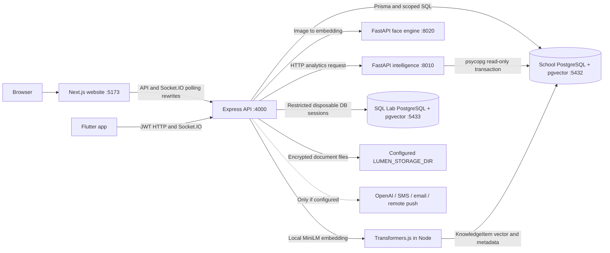

# Meridian system architecture

Current architecture of the Next.js/PostgreSQL edition. [README.md](README.md) explains startup; [PROJECT_LAYOUT.md](PROJECT_LAYOUT.md) locates implementation files; [TECHNOLOGY JUSTIFICATION.md](TECHNOLOGY%20JUSTIFICATION.md) explains the choices.

## Process and data topology

There are six local server/database components: four HTTP processes and two PostgreSQL clusters. pgvector is an extension inside each PostgreSQL cluster. Flutter is a client, and the browser does not call the Python engines directly.

## Website and shared API

Next.js serves an App Router layout/catch-all page and loads the existing React application inside a client boundary. React Router handles its screen routes. Axios uses relative `/api` paths; Next rewrites forward them to Express. Socket.IO polling has a corresponding rewrite, with an optional direct socket origin configuration.

Flutter uses the same Express origin for HTTP and realtime. It appends `/api` internally, so `MERIDIAN_API_BASE` must not contain that suffix. Android USB demos forward port 4000 through `adb reverse`; an emulator uses `10.0.2.2`.

Sources: [Next config](client/next.config.mjs), [client boundary](client/src/app/client-app.tsx), [React shell](client/src/NextApp.tsx), [web API client](client/src/lib/api.ts), [Flutter API settings](flutter_app/lib/core/config/env.dart).

## Authentication and authorization

Express validates JWTs and checks the live account for role, activity, token version and password-change requirements. Backend routes apply role and ownership checks. React/Flutter guards provide navigation behavior, while backend checks enforce access to the API.

The relational User row stores six application roles. KnowledgeItem adds native database enforcement: the service sets authenticated actor/school context and switches to the restricted `meridian_knowledge` PostgreSQL role inside a transaction. Its RLS policies implement authorized staff reads and administrator writes. Other operational endpoints continue using backend authorization and database constraints; they are not all RLS-protected.

Sources: [middleware](server/src/middleware/auth.ts), [live session](server/src/lib/live-session.ts), [knowledge transaction context](server/src/services/knowledge.ts), [RLS SQL](database/advanced.sql).

## Persistent school database

The current exported schema has 43 application tables. Student/guardian identity, classes, rooms, timetables, attendance, fees/payments, documents, notifications and audit/workflow records share the same school database. Internal Prisma migration bookkeeping is excluded from application ER diagrams.

Versioned relational migrations and the advanced/integrity SQL installer jointly prepare the schema. PK/FK/UNIQUE/CHECK constraints, tenant-reference triggers and calendar validation provide database-level integrity. A stored payment function uses a row lock and one transaction for Payment insertion and Fee balance/status updates.

School can have many timetable versions. A partial unique index permits only one active published version per school; it does not make the general School-to-Timetable relationship 1:1.

Sources: [live dictionary](database/rubric/SCHEMA.md), [schema mapping](database/rubric/diagrams/RELATIONAL_MAPPING.md), [migrations](server/prisma/migrations), [advanced SQL](database/advanced.sql), [integrity SQL](database/integrity.sql).

## Mandatory QR + face attendance

1. An authorized staff member starts a session for an allowed class. The backend creates a random token, expiry and per-student verification rows.
2. The website projects a real QR. A signed-in student scans it from Flutter or the browser route.
3. The QR proof and matching face proof can arrive in either order. A single factor remains incomplete.
4. The engine verifies both stored proofs for the same student in the same active session before finalizing Present. Mismatches are blocked, and repeat/concurrent checks must not create duplicate completion records.
5. Web/mobile follow the stored verification state. Closing/expiring a session resolves incomplete states and makes the old token unusable.

The database also checks that a new/updated Present verification carries both proof timestamps and passing confidence. Its historical-row NOT VALID declaration preserves older records while still enforcing new writes. Legacy manual Present/Late endpoints cannot bypass the rule; Absent/Leave corrections remain available.

Sources: [session lifecycle](server/src/services/presence/session.ts), [engine](server/src/services/presence/engine.ts), [student progress endpoint](server/src/routes/presence/session.routes.ts), [database CHECK](server/prisma/migrations/202611100002_dual_attendance/migration.sql), [test procedure](docs/QR_ATTENDANCE.md).

## Face embedding boundary

The browser/native camera captures a frame. Node forwards it to the FastAPI face service, which decodes it, checks detection/quality and computes a 512-D InsightFace template using CPU ONNX inference. Node validates model/dimension consistency and handles enrollment, consent records, matching, school scope and attendance decisions. Raw face frames are processed in memory rather than stored as face-enrollment photos.

FaceEmbedding stores serialized vectors in a text field and Node computes cosine matches. This is separate from the native pgvector text-knowledge feature. The current flow does not claim a certified anti-spoof/liveness implementation or require a blink gate.

Sources: [face engine](faceservice/app.py), [Node face service](server/src/services/face.ts), [browser capture](client/src/lib/camera.ts), [enrollment guide](docs/FACE_RECOGNITION.md).

## Semantic Knowledge Library

The Node knowledge service embeds a title plus focused text using `Xenova/all-MiniLM-L6-v2`. It stores a normalized 384-D vector with school/category/model/provenance metadata. A question uses the same model and ranks stored entries by cosine distance, optionally filtered by category. Updates re-embed text; the audit trigger advances revisions and records create/update/delete history.

A native HNSW index supports approximate retrieval, while PostgreSQL can choose exact scans for small datasets. Similarity is a relevance score, not a calibrated probability. KnowledgeRevision snapshot identifiers intentionally remain without declared FKs so audit history can survive deletion of the searchable item.

Sources: [knowledge service](server/src/services/knowledge.ts), [routes](server/src/routes/knowledge.routes.ts), [DDL](database/advanced.sql), [verified vector examples](database/rubric/06_pgvector).

## Lumen document pipeline

PDF.js reads digital text/form data; scanned pages go through local image preparation and Tesseract.js OCR. Classification/extraction, validation, confidence and field evidence feed a human review stage before supported record creation. Node handles document processing; this is not the analytics Python service's job.

Stored originals/previews use an AES-256-GCM envelope and authenticated school-scoped reads. The configured directory and its original storage key must remain with database backups. The current computer uses a document directory under ignored `tmp`, so blanket temporary-folder deletion would lose real document files.

Sources: [pipeline](server/src/services/lumen/index.ts), [ingest](server/src/services/lumen/ingest.ts), [OCR](server/src/services/lumen/ocr.ts), [storage](server/src/services/lumen/storage.ts), [commit](server/src/services/lumen/commit.ts).

## Intelligence and scheduling

The Python analytics loader uses psycopg with a repeatable-read, read-only PostgreSQL transaction. pandas/NumPy build features, SciPy supports statistical forecasts, and IsolationForest is used for supported anomaly observations. Explanations and data-sufficiency handling accompany recommendations. Optional prose refinement does not replace the underlying calculations.

Kairos timetable generation/validation/publication runs in the Node services. It enforces school scheduling constraints and maintains version/publication workflows. Substitute/cascade logic uses the same operational school records.

Sources: [analytics loader](intelligence/app/db.py), [inference](intelligence/app/inference/engine.py), [forecasting](intelligence/app/forecasting/forecast.py), [Kairos](server/src/services/kairos).

## SQL Lab isolation

Editable SQL runs on a **separate PostgreSQL cluster** identified as `meridian-sql-lab`. A fictional template is cloned into restricted disposable sessions. A worker receives only that session's database credentials. Session limits, timeouts, reset and cleanup control resource use. These queries do not execute on the website's school connection.

By comparison, the standalone rubric collection intentionally operates on the actual school schema. Read queries use real records; demonstration writes/DDL use explicit rollback transactions. PostgreSQL audit sequences can still advance even when demo rows roll back.

Sources: [native isolation](server/src/services/nativeSqlLab.ts), [orchestrator](server/src/services/sqlLab.ts), [worker](server/sql-lab/worker.mjs), [lab guide](docs/dbms/SQL_LAB.md), [rubric runner](database/rubric/run-examples.mjs).

## Realtime, event history and failure behavior

Socket.IO provides authenticated updates, with clients refetching authorized API state. Notification read state is per user. Event/AuditLog/AILog and related records support traceability and selected reversible operations; they are not a universal backup system or a claim that every table is reconstructed from an event stream.

If a Python service is unavailable, its feature reports an offline/error state. Optional OpenAI and notification providers need real configuration; in-app realtime is not proof of remote delivery. The current deployment uses a single Express process without a Redis adapter.

Sources: [socket server](server/src/lib/socket.ts), [notifications](server/src/services/notifications.ts), [event store](server/src/services/eventStore.ts), [trust ledger](server/src/services/trustLedger.ts).

## Operations and verification

The configured Windows setup uses [start-native.ps1](scripts/start-native.ps1) for the installed clusters and existing built apps. Fresh clones can use [Compose](docker-compose.yml) for database services and explicit Node/Python foreground commands. The [health checker](scripts/check-services.mjs) tests each of the six components; the API HTTP heartbeat alone is not a database probe.

Operational commands, logs, shutdown steps, mobile addresses and environment preservation are in [README.md](README.md). SQL and image verification records distinguish actual executed checks from hardware/provider/platform work that still needs its own environment.
